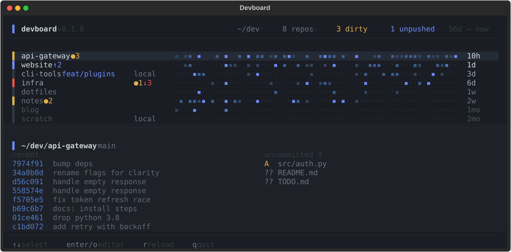

# devboard

[](https://github.com/pyvnoaim/devboard/actions/workflows/ci.yml)
[](LICENSE)

What did I leave unfinished. A terminal dashboard for a folder of git repos.



Repos sort by last commit, freshest first.

## Install

```sh
uv tool install git+https://github.com/pyvnoaim/devboard
```

Needs `git` and [uv](https://docs.astral.sh/uv/), on macOS or Linux. Update with `uv tool upgrade devboard`.
Try it without installing: `uvx --from git+https://github.com/pyvnoaim/devboard devboard`.

## Run

```sh
devboard                # scans ~/dev
devboard ~/work         # or any folder of repos
devboard --selftest     # the pure functions: ages, flags, the strip's geometry
devboard --smoke        # boots it headless and checks the layout holds together
```

From a clone, `./devboard.py` runs it directly.

## Keys

| key | does |
| --- | --- |
| `↑` `↓` | select a repo (the lower panel follows) |
| `enter` / `o` | open it in your editor |
| `r` | rescan now (it also rescans every 15s) |
| `q` | quit |

Editor is `$DEVBOARD_EDITOR`, else the first of `code`, `cursor`, `zed` it finds, else `open`
(`xdg-open` on Linux) — a GUI
one, so opening a repo never fights the TUI for the terminal.

## Reading a row

- **Left bar** — the worst thing about the repo: red behind the remote, amber dirty, blue
  unpushed, grey nothing to answer for.
- **Name** — dims as the repo goes quiet: bright under 2 days, then a week, a month, older.
- **Badges** — only when something needs attention: `●3` uncommitted, `↑2` unpushed, `↓2`
  behind, `local` no upstream. A clean synced repo says nothing.
- **Strip** — one cell per day, grouped into weeks, today at the right edge. Brighter blue is
  more commits that day, scaled against that repo's own busiest day in view.
- **Age** — time since the last commit.

The strip shows as much history as the window is wide, in whole weeks, up to a year: widen the
terminal and you see further back. The header says how far (`175d → now`).

## Lower panel

Recent commits for the selected repo, and its uncommitted files when it has any — when it
doesn't, the history runs on into the second column. The panel hides itself on a terminal too
short to hold it and gives the space back to the board.

## License

[MIT](LICENSE)
